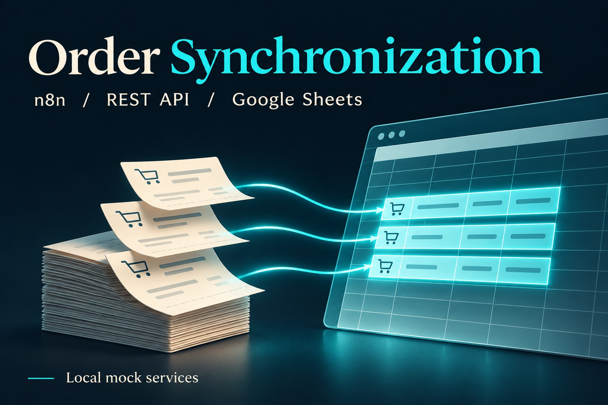
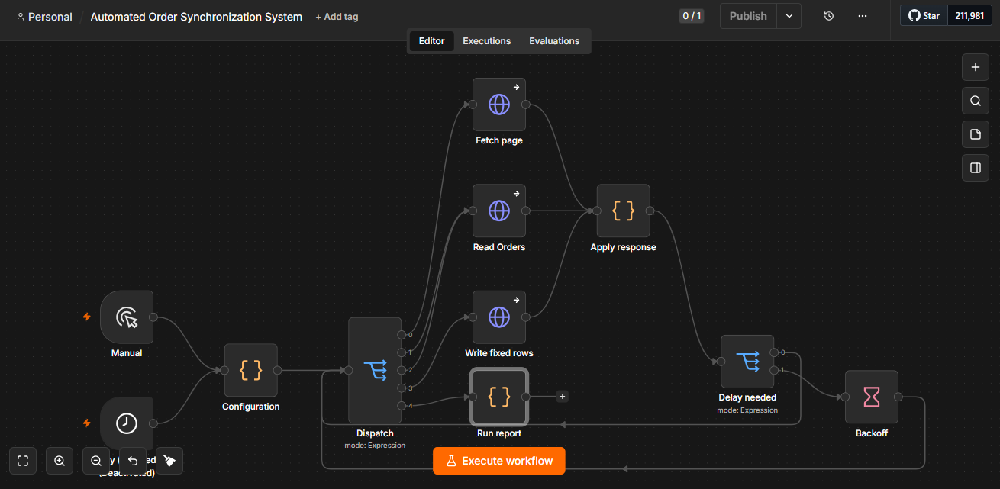
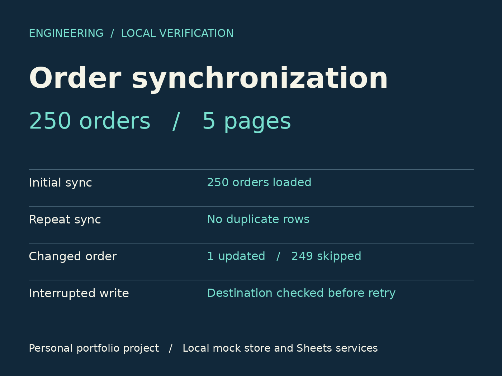

# Automated Order Synchronization System

An importable, inactive n8n workflow that mirrors REST orders into the five managed columns of an Orders worksheet. The shipped configuration connects only to a loopback mock. No external accounts or dependencies are required for the mock or unit tests.



## Workflow overview



## Local verification

This personal portfolio project was exercised by the author in a local Node.js-based n8n installation with simulated store and Sheets endpoints. The first synchronization read 250 synthetic orders across five pages. Repeating the sync produced no duplicates. Changing one order updated its row and skipped the other 249. Local checks also covered HTTP 429 handling, recovery after an interrupted write and stopping on HTTP 403.



See [the verification record](TESTS.md) for the distinction between the author’s manual checks and the automated engine suite.

## Run locally

1. Unzip the archive and open a terminal in its project folder. Use Python 3.10+ and a local n8n installation. For the tests use Node.js 18+.
2. Run `python3 mock.py`. Keep it running. Its 250 fictional orders are in `fixtures/orders.json`. The mock sheet persists across workflow executions in this process and resets when the server stops.
3. Import `workflow.json` from file into n8n. Choose **Manual** and execute. Open **Run report**. Expect 5 pages, 250 added. Execute again against the same mock process and expect 250 skipped.
4. For a fault demo, restart the mock with `python3 mock.py --page-fault 429 --write-fault drop_after_commit`. The first page is throttled and the first batch commits before the connection closes.
5. Read [the architecture](ARCHITECTURE.md), [Arabic walkthrough](GUIDE-AR.md), and [test record](TESTS.md).

The default origin is 127.0.0.1:18765 **from the n8n process**. For Docker on your machine, run the mock inside the same network namespace as n8n (for example, mount this project in a Python container started with `--network container:<your-n8n-container>`). Do not expose the fixture on a public interface.

## Run the tests

```sh
node --test tests/sync.test.cjs
python3 tests/engine.py
```

Stop the standalone mock before the engine test. The harness starts its own fixture on 18765 and creates a temporary n8n SQLite profile. Run it with an isolated, standard local CLI in a clean environment without external database or queue settings. Avoid port conflicts with other n8n processes. Set N8N_BIN to an absolute CLI path if required. LAB_TMP optionally sets a parent directory visible to that CLI. Use a service-mode n8n deployment to resume long persistent Wait executions.

## Adapting a separate copy to real services

Keep scheduling disabled during setup. Set Configuration.source to an HTTPS orders endpoint implementing the cursor and field contract in ARCHITECTURE.md. Configure authentication on Fetch page via n8n credentials. Create a dedicated Orders tab, put the five exact headers from ARCHITECTURE.md in row 1, and provision enough grid rows. Set Configuration.sheet to `https://sheets.googleapis.com/v4/spreadsheets/YOUR_SPREADSHEET_ID`. On Read Orders and Write fixed rows select predefined Google Sheets OAuth2 credentials with appropriate access. The workflow uses raw text values to preserve identifiers and make comparisons exact. Use a separate tab for analytics. Test on a disposable spreadsheet before enabling scheduled runs. Review the single-writer conditions first.

For changes to transition logic, edit src/sync.js, run `python3 build.py`, re-run both suites and import the rebuilt workflow. The exported JSON is self-contained.
